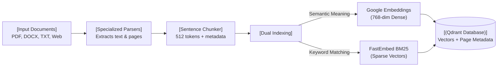
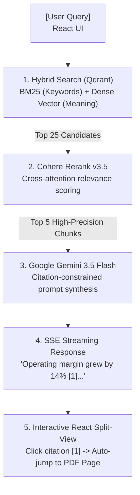

# DocuNexus 📚⚡

> **Multi-Document Knowledge Base** with Hybrid Search (BM25 + Vector Similarity), Cohere Reranking, and Verifiable Source Attribution.

Built with **LlamaIndex**, **Qdrant**, **Cohere Rerank**, **Google Gemini**, **FastAPI**, and **React**.

---

## 🌟 Key Features

- **Multi-Format Ingestion**: Ingest PDFs (with 1-indexed page tracking), DOCX (headings & tables), plain text, and web pages (clean article extraction).
- **Hybrid Retrieval**: Combines sparse lexical keyword search (BM25) with dense vector similarity (Google `text-embedding-004`, 768-dim) in Qdrant.
- **Precision Reranking**: Utilizes Cohere Rerank (`rerank-v3.5`) to reorder the top 25 candidate chunks down to the 5 most relevant passages.
- **Traceable Source Attribution**: Every claim in the generated answer includes interactive citation badges (`[1]`, `[2]`) linked to the exact source document, page number, and text snippet.
- **Real-Time Streaming**: Token-by-token streaming via Server-Sent Events (SSE) with interactive side-by-side preview.

---

## 🏗️ System Architecture

### 1. Document Ingestion Flow (Write Path)



### 2. Search & Source Attribution Flow (Read Path)



---

## 📁 Repository Structure

```text
DocuNexus/
├── backend/                  # FastAPI backend & LlamaIndex RAG pipeline
│   ├── app/
│   │   ├── api/v1/endpoints/ # API routes (/documents, /query)
│   │   ├── core/             # Configuration & Qdrant client
│   │   ├── services/         # Parsers, chunking, and catalog
│   │   └── schemas/          # Pydantic data schemas
│   ├── storage/uploads/      # Local document storage
│   ├── tests/                # Automated unit & integration tests
│   └── requirements.txt      # Python dependencies
├── frontend/                 # React frontend (Vite)
│   ├── src/                  # React components, styles, and dashboard
│   └── package.json          # Node dependencies
├── .env.example              # Environment variables template
├── .gitignore                # Git exclusions
├── docker-compose.yml        # Qdrant vector database container
└── README.md                 # Project documentation
````

---

## 🚀 Quickstart

### 1. Start Qdrant Vector Database
```bash
docker compose up -d
```
* Dashboard: `http://localhost:6333/dashboard`

### 2. Configure Environment
Copy `.env.example` to `.env` in the root directory and add your API keys:
```env
GEMINI_API_KEY=your_gemini_api_key_here
COHERE_API_KEY=your_cohere_api_key_here
```

### 3. Run Backend (FastAPI)
```bash
cd backend
# Activate virtual environment
.\venv\Scripts\activate
# Start Uvicorn server
uvicorn app.main:app --reload --port 8000
```
* API Docs (Swagger): `http://localhost:8000/docs`
* Health Check: `http://localhost:8000/health`

### 4. Run Frontend (React + Vite)
```bash
cd frontend
npm install
npm run dev
```
* Web App: `http://localhost:5173`


